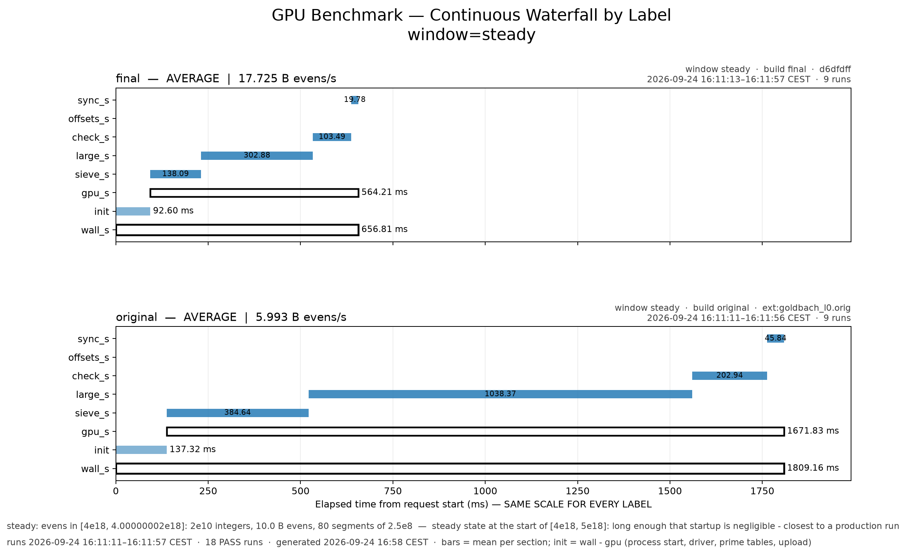

<h1 align="center">goldbach-tools</h1>

<p align="center">
  <b>Benchmarks, validators and driver bug reproducers for the Goldbach verifier.</b><br>
  <a href="https://github.com/SINF-KEN/goldbach-l0">goldbach-l0</a> ·
  <a href="https://github.com/SINF-KEN/goldbach-web">goldbach-web</a> ·
  <a href="https://goldbach.net01.io">Live campaign</a>
</p>

<p align="center">
  
</p>

Clone this next to `goldbach-l0`, which picks it up through its
`tools -> ../goldbach-tools` link and builds the C++ tools with its own CMake project.

Flat layout, ordered roughly by how load-bearing the tool is (benchmarks and
validators at the top level, one-off experiments under dev/):

```
tools/
├── bench.py, waterfall.py               benchmark harness + timing-waterfall plots (start here)
├── run_range.sh                         resumable production run over [START, LIMIT]
├── sweep.py, benchmark.cpp, tuner.cpp   parameter sweeps and tuning — safe, production-shaped configs
├── debug_*.cpp                          bit-exact GPU-vs-CPU kernel validators
├── tty_*.sh                             headless/TTY runners (production loop, Isaac suite, one-command cycle)
└── dev/                                  live driver/compiler bug repro trees
```

## Measure and tune

| Tool | What it does |
|---|---|
| `bench.py` | The benchmark to use. Fresh process per run, rounds interleaved across arms (builds / env settings) and windows (`bench` 2e9 @4e18, `steady` 2e10 @4e18, `end` 2e10 below 5e18, plus `long` 1e11 @4e18 and `long-end` 1e11 below 5e18 for small effects), warm-ups discarded. Records clock, temperature, throttling, energy and **other processes' share of the B580** (`other_gpu_pct`, from xe fdinfo) per run. Prints medians, means with t-based 95% CIs, and paired geometric-mean ratios with CIs and a faster/slower/unresolved verdict. `--target-ci PCT` keeps adding rounds until every CI is within ±PCT% (capped by `--max-runs`/`--max-minutes`); `--exclude-contended PCT` drops runs where other processes used the GPU. Appends to `<goldbach-l0>/bench/bench-results.csv`. Stdlib only (TTY-safe). **Does not isolate the campaign statistics files**: set `GB_STATS_STATE`, `GB_STATS_LOG`, `GB_RIDGE_FILE`, `GB_RECORDS_FILE`, `GB_STATS_LIVE` to a scratch directory and `GB_RECORD_HOOK=` when benchmarking next to a campaign. |
| `waterfall.py` | Timing waterfall per date / arm / window from `bench/bench-results.csv` (or `sweep-results.csv`), with run times and window descriptions. Times are normalized to 1e10 integers when windows of different size are plotted together (`--per auto`; `--per none` for raw ms). `--latest` plots only the most recent bench.py session per label and window. Small phases are labelled beside their bar. Needs pandas + matplotlib: `python3 -m venv .venv && .venv/bin/pip install pandas matplotlib`. |
| `tty_baseline.sh` | Best-quality baseline in one command: `sudo bash tools/tty_baseline.sh [full|quick]` stops the desktop, runs bench.py (bench/steady/end x 12, long/long-end x 40; `quick`: 5 / 10) with the B580 to itself, then restores the desktop by itself (phase 2 runs as a transient systemd service with `IgnoreOnIsolate=yes`, so it survives the session teardown that killed the old setsid launch; EXIT trap + time ceiling). Tables in `<goldbach-l0>/tty-baseline-last.txt`, rows appended to `bench/bench-results.csv`. `BASELINE_ARMS` adds interleaved reference builds; `TTY_BASELINE_DRY=1` tests it with the desktop up. |
| `live_stats.sh` | Live dashboard for a `run_range.sh` campaign in a second terminal: `bash tools/live_stats.sh START LIMIT [JOURNAL] [INTERVAL_S]`. Progress, rate and ETA from the journal plus the running verifier's per-segment stderr feed (sparse and dense formats), GPU clock / temperature / power from sysfs. Read-only. |
| `run_range.sh` | Production runner: slices [START, LIMIT] into fresh processes, journals every PASS, resumes after the last contiguous PASS, retries once then stops on failure, `GB_BUCKET_VERIFY=100` tripwire. |
| `sweep.py` | Segment/split parameter sweeps. Every sample is a **fresh** `goldbach_l0` process (no state leaks, one crash can't poison the next point); appends to `sweep-results.csv` and prints medians with CV%. |
| `benchmark.cpp` → `goldbach_bench` | Multi-run pipeline benchmark with warm-up discard; prints per-phase GPU times. |
| `tuner.cpp` → `goldbach_tuner` | Staged, safety-gated auto-tuner for the near-4e18 window (health probe → easy segment sweep → gradual split sweep → fine grid → soak). Journals to `tuning-*.csv`. |

Example — `waterfall.py tests/fixtures/bench-sample.csv --window steady
--group-by label` (v1.7.0 "final" vs the v1.6.2 binary, 9 runs each):


CI (`.github/workflows/ci.yml`) renders these figures from the fixture on
every push and uploads them as the `waterfall-figures` artifact.

`bench.py`, `sweep.py` and the tuner never delete or rewrite their CSV journals — rows are
append-only so history stays comparable across code changes.

## Validate — prove the kernels correct

Each tool isolates one kernel and compares bit-for-bit against an independent
CPU reference (deterministic Miller-Rabin, not a re-run of the same algorithm).
Run all of them after changing `kernels/goldbach.cl`, `config.hpp`, or any
table/offset math:

```bash
./build/debug_sieve   # make_prime_map alone vs CPU sieve
./build/debug_check   # make_prime_map + check_numbers vs CPU Goldbach check
./build/debug_map     # COMPLETE map: mask path + tile table + large kernel
./build/debug_fb      # large-prime first-mark offsets + packed-prime decode vs host
./build/debug_check_hi  # every checker (two-phase included) in the production geometry
```

The sparse class map (`--sparse`, `kernels/sparse.cl`) has its own validator;
run it for both geometries (`GB_SCM_M=2310` / `30030`, default 30030) after
changing `sparse.cl`, `include/sparse.hpp` or `src/sparse.cpp`:

```bash
./build/debug_sparse map 4000000000000000000 8000000      # full segment: every map bit vs an
                                                          # independent CPU sieve + MR spot checks
./build/debug_sparse check 4000000000000000000 16384 real # phase A + B vs a per-even CPU reference
GB_SCM_RESTCAP=6 ./build/debug_sparse check 4999999000000000000 4096 60 11   # random map, leftovers
```

The bucket sieve spans segments, which none of these see: validate it with
the verifier itself, `GB_BUCKET_VERIFY=1 ./build/goldbach_l0 --start
4000000000000000000 --limit 4000000030000000000` (rebuilds every segment's
map without buckets and compares word for word; throws on any difference).

Expected output is `OK` / zero diffs. Two caveats:

- `debug_check` reports 1 miss at `n=4` — that is *correct*: 4 = 2 + 2 needs
  the prime 2, which is outside the odd-only candidate list.
- These tools drive kernels with unusual argument combinations. Only run
  production-shaped configs; a wedged GPU poisons everything measured after it
  (see the gpu-benchmark skill).

**Stale-binary trap:** the validators bake in the constants from
`include/config.hpp`. After changing any constant, rebuild them (`bash
build.sh`) before trusting a pass/fail — a stale copy can report false
failures.

## dev/ — live repro trees

Each remaining tree is tied to an open upstream thread or a standing safety
net. The concluded experiments were removed 2026-09-21 (CPU kernel
simulations, shift/atomic probes, atomic-bench and multi-queue gates,
metrics enumeration, ISA dumps, the zello metrics sample) — git history
retains all of it.

- `igc-static-inline-repro/` — ocloc/IGC 64-bit-atomic repro kernels with
  issue drafts (the "static inline atomic_and bug" was refuted: reserved
  word `half`; 64-bit `atomic_and` is absent per spec — `atom_and` is the
  64-bit spelling). IGC#441 draft lives here.
- `l0-visibility-test/` — memory-visibility probes that pinned down the
  barrier-vs-event-wait flush semantics, plus the EventPool count=0 abort
  repro (filed upstream as intel/compute-runtime#990). Re-run first if map
  corruption ever reappears.
- `ocl-heap-corruption/` — the heap-corruption repro tree filed as
  intel/compute-runtime#991 (sources + logs; compiled binaries not
  tracked). Attachment source for triage — keep while the issue is open.

The `.spv`/`.bin` files in these folders are build artifacts of the probe
kernels, not sources; compiled host executables are not tracked.
